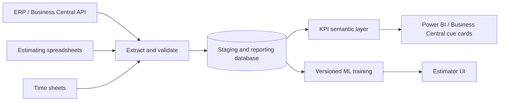

# Proposed integration architecture (illustrative)

**Implemented in this repository:** synthetic CSV ingestion, validation, SQLite reporting, a Streamlit KPI dashboard, and a predictive estimation interface.

**Future production integration:** authenticated Business Central OData/API ingestion, incremental sync and retries, orchestration, audit logs, row-level security, Power BI semantic model, Business Central extensions, model monitoring, human approval and deployment controls. No real Business Central integration is claimed here.
